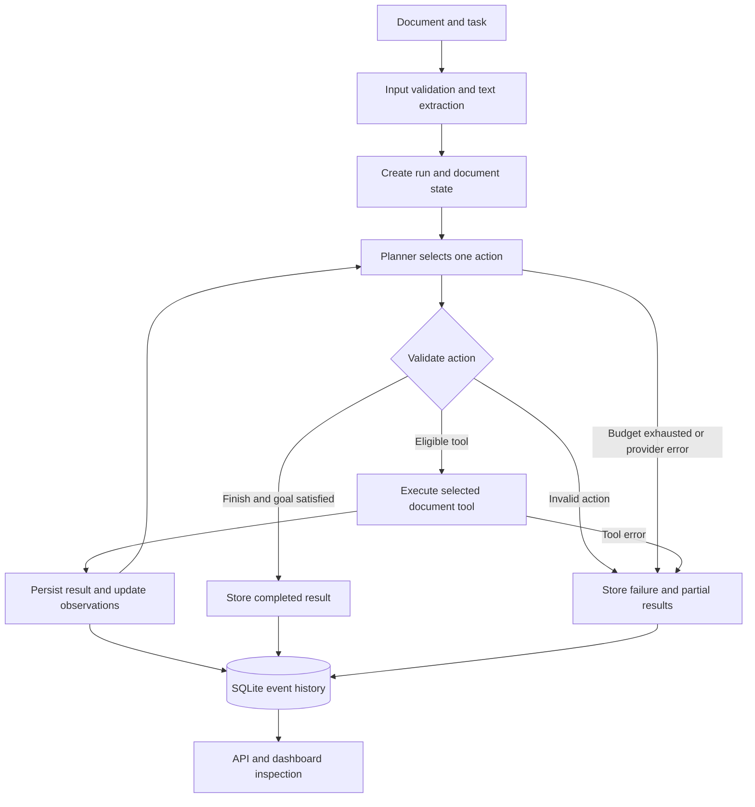

# Agent architecture

The planner is a replaceable component. Offline mode uses explicit branching
rules; OpenAI mode sends the allowed function schemas and current observations
to a model on every step. The API adapter uses independent Responses requests
with the complete observed state, so it does not depend on provider-side
conversation storage or a previous response ID.

The policy layer supplies task boundaries and tool prerequisites, not one
mandatory global tool order. Metadata extraction may precede classification
in model mode; summary-only tasks do not need either. The model adapter test
demonstrates a valid order different from the offline planner.

| Component | Responsibility |
|---|---|
| `ingestion.py` | Validate file type, size and readable text |
| `models.py` | Per-run document, decision and observation state |
| `planner.py` | Choose one eligible action based on observations |
| `policy.py` | Define task goals and prerequisite gates |
| `agent.py` | Execute the loop and persist its audit events |
| `tools.py` | Perform the eight document functions |
| `repository.py` | Store runs/events and query explicitly indexed revisions |
| `server.py` | Receive submissions and expose inspection APIs |
| `web/` | Upload interface, decisions, findings and run history |

Source document text and retrieved reference text are data. No tool executes
code from a document. The registered functions cannot run shell commands, send
emails or grant engineering approval. Final recommendations name a suggested
human action and explicitly identify that no external action was executed.

The diagram's loop is the assignment's central behavior: every executed tool
changes the observations available for the next tool choice.
