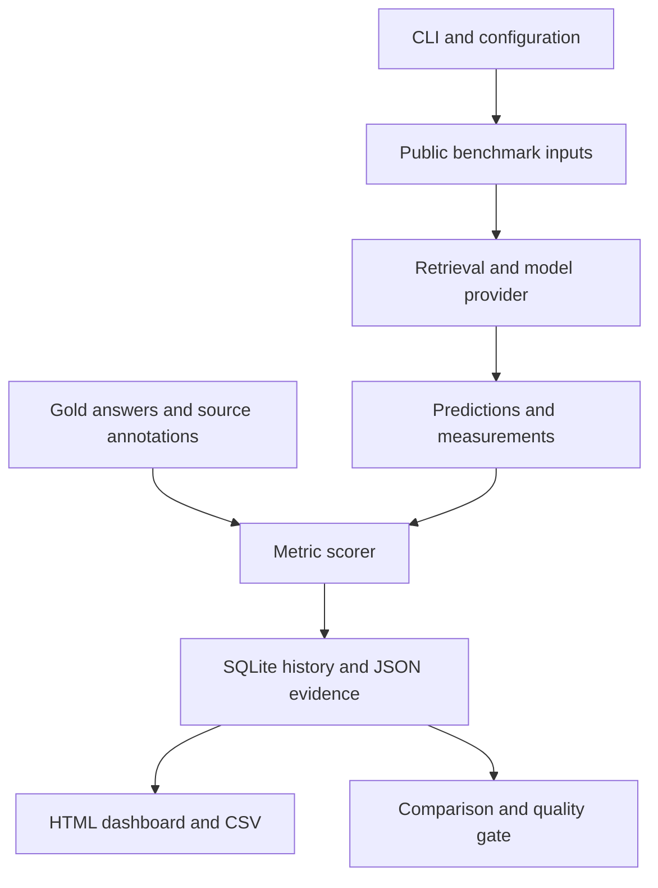

# Architecture

`common.py` validates source/annotation integrity and defines the public-input allowlist. `retrieval.py` implements lexical and vector retrieval. `classifiers.py` fits local statistical models. `providers.py` normalizes local, live API and replay outputs. `metrics.py` uses only declared scoring conventions. `runner.py` orchestrates execution, recording timestamps and identities. `storage.py` checkpoints completed cases. `report.py` embeds evidence in a self-contained browser report. `gates.py` checks configurable metric thresholds.

Providers never receive the gold label/fact objects. The scorer sees both prediction and gold after inference. Classification input titles are removed before inference. The dashboard uses DOM text content for user-controlled values and escapes embedded JSON to prevent script termination through model text.

The local HTTP server is read-only and binds to 127.0.0.1. It serves the selected output directory; it is a demonstration server, with no public deployment or authentication built in. SQLite is for local runs; concurrent multi-worker orchestration is outside this assignment's scope.
