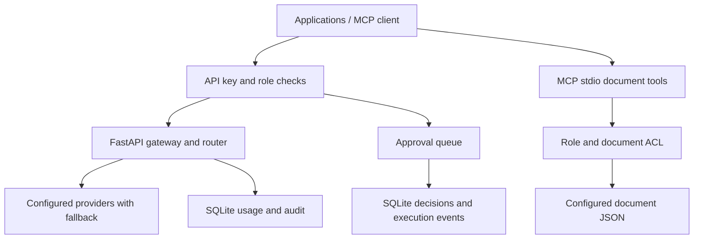

# Architecture

The API client sends one request to `/v1/gateway/chat`; routing config selects eligible models using the evaluation scorecard, and the provider adapter handles retries/fallback. Workflow submissions are analyzed and classified by confidence/risk rules. Pending work is executed only after reviewer approval or modification. MCP tools use the same document access service and record tool-call events. All externally supplied strings are bounded; injection signals are blocked at the chat endpoint and document content is treated as untrusted. The model receives no tool execution authority from its natural-language output.

## MCP tools

`search_documents`, `get_document_metadata`, `get_document_content`, `search_knowledge_base`, `compare_revisions`, `get_related_documents`, `validate_document`, and `summarize_document`.

## Trust boundaries

- HTTP API: shared API keys map to roles and user IDs. Demo keys are public placeholders.
- MCP: stdio inherits local process identity; remote deployments require an authenticated MCP host/proxy.
- Documents: JSON content is untrusted input; detected instruction-like phrases are escalated for review.
- Persistent state: local SQLite; replace for multi-instance deployment.
