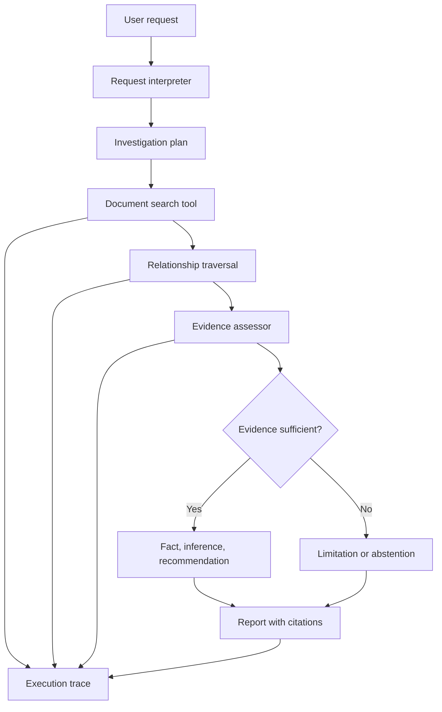

# Architecture

## Components

- `app/agent.py` owns request interpretation, investigation planning, ranked lexical retrieval, relationship traversal, signal selection, citations, and report generation.
- `data/project.json` is the simulated document store. Each record has stable identity, type, date, status, relationships, text lines, and labeled evidence signals.
- `app/evaluation.py` runs the labeled scenario set and computes micro precision, recall, F1, exact-scenario accuracy, and citation coverage.
- `app/server.py` exposes `GET /health` and `POST /investigate` on a local standard-library HTTP server.
- Every orchestration step adds a trace record with sequence, selected tool, inputs, and result summary.

## Investigation sequence

1. Interpret the request and choose the focus areas.
2. Create an explicit plan for searching, following links, checking evidence, and writing the report.
3. Retrieve directly relevant documents using deterministic lexical overlap ranking.
4. Read directly retrieved documents and traverse their declared relationships; all calls are recorded.
5. Select only open or unresolved signals from directly retrieved records. Related records provide context and can also surface independently through search.
6. Attach source IDs, titles, line numbers, and quoted source lines.
7. Render separate fact, inference, and recommendation fields. Preserve source disagreements as conflicts.

The sample retrieval engine is intentionally small and inspectable. It is not semantic RAG and does not use an LLM. Replace `search_documents` and the signal extractor with access-controlled enterprise connectors and reviewed extraction components before using real records.
